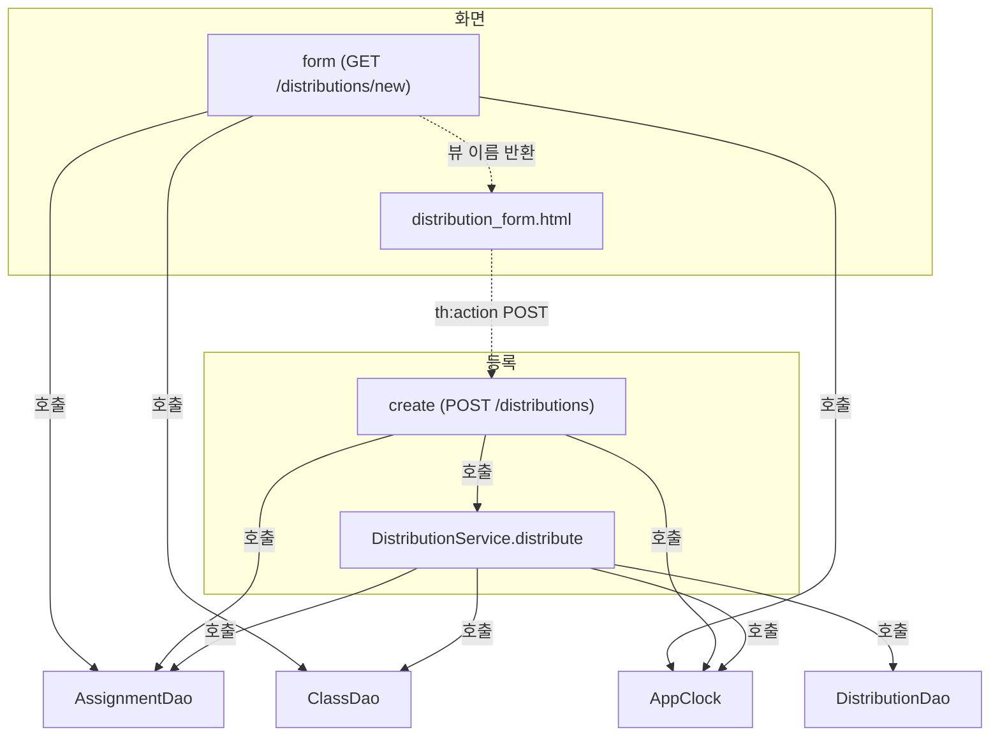

# assignment 모듈 구조 — 새 과제 배포 화면 · 등록 처리

## 개요
- `legacy/assignment-thymeleaf`는 Spring MVC + Thymeleaf + `JdbcTemplate` 기반 과제 배포 관리 화면이다 (`legacy/assignment-thymeleaf/src/main/resources/templates/layout.html:35`의 푸터 문구는 v1.4.2).
- 이 문서는 "새 배포" 화면(`GET /distributions/new`)과 그 폼의 등록 처리(`POST /distributions`)만 다룬다.
- 컨트롤러가 화면용 목록을 DAO에서 직접 읽고, 등록은 `DistributionService.distribute`에 맡긴다.
- DB는 MariaDB `itembank`이며 `unit`, `assignment`, `class`, `distribution` 테이블을 쓴다 (`legacy/assignment-thymeleaf/src/main/resources/application.properties:2`).
- 시각은 `AppClock.now()`가 주며, 기본값이 고정 시각이다 (`BUSINESS-RULES.md`의 BR-08 참고).

## 분석 범위
- 포함: `DistributionController.form` · `create`, `distribution_form.html`, 그 안에서 쓰는 `layout.html` fragment, 직접 호출하는 DAO · 서비스 · `AppClock` · 모델 클래스(`AssignmentRow`, `ClassRow`).
- 제외: 재배포(`redistribute`), 배포 목록(`list`, `distributions.html`), `AssignmentController`, `assignments.html`, `DbErrorAdvice`, `build/`, `.gradle/`.
- 제외한 파일의 같은 클래스에 있는 코드는 읽었더라도 분석하지 않았다.

## 폴더 구조 (범위 안만)
```
legacy/assignment-thymeleaf/src/main/
├─ java/com/example/assign/
│  ├─ AppClock.java                         # 현재 시각 · 시각 포맷
│  ├─ web/DistributionController.java       # GET /distributions/new, POST /distributions
│  ├─ service/DistributionService.java      # distribute (등록)
│  ├─ dao/AssignmentDao.java                # 과제 조회
│  ├─ dao/ClassDao.java                     # 학급 조회
│  ├─ dao/DistributionDao.java              # 배포 중복 확인 · 번호 채번 · INSERT
│  └─ model/AssignmentRow.java, ClassRow.java
└─ resources/templates/
   ├─ distribution_form.html                # 새 배포 폼
   └─ layout.html                           # head · nav · flash · footer fragment
```
스키마는 모듈 밖 `db/mariadb/init/01-schema.sql`에 있다.

## 진입점
| 진입점 | HTTP | 메서드 (파일:줄) | 결과 |
|---|---|---|---|
| 새 배포 화면 | `GET /distributions/new` | `DistributionController.form` (`legacy/assignment-thymeleaf/src/main/java/com/example/assign/web/DistributionController.java:40-47`) | 뷰 `distribution_form` 렌더링 (`legacy/assignment-thymeleaf/src/main/java/com/example/assign/web/DistributionController.java:46`) |
| 배포 등록 | `POST /distributions` | `DistributionController.create` (`legacy/assignment-thymeleaf/src/main/java/com/example/assign/web/DistributionController.java:49-77`) | 성공 시 `redirect:/distributions` (`legacy/assignment-thymeleaf/src/main/java/com/example/assign/web/DistributionController.java:76`), 실패 시 `redirect:/distributions/new` (`legacy/assignment-thymeleaf/src/main/java/com/example/assign/web/DistributionController.java:56`, `legacy/assignment-thymeleaf/src/main/java/com/example/assign/web/DistributionController.java:63`, `legacy/assignment-thymeleaf/src/main/java/com/example/assign/web/DistributionController.java:71`, `legacy/assignment-thymeleaf/src/main/java/com/example/assign/web/DistributionController.java:74`) |

폼 → 등록 연결: `<form method="post" th:action="@{/distributions}">` (`legacy/assignment-thymeleaf/src/main/resources/templates/distribution_form.html:8`).

## 흐름도

실선은 메서드 호출, 점선은 호출이 아닌 연결(뷰 렌더링 · 폼 제출)이다.

## 호출 표 (`A → B`: A가 B를 호출)
| 호출 | 위치 |
|---|---|
| `DistributionController.form → AssignmentDao.findAllForSelect` | `legacy/assignment-thymeleaf/src/main/java/com/example/assign/web/DistributionController.java:42` |
| `DistributionController.form → ClassDao.findAll` | `legacy/assignment-thymeleaf/src/main/java/com/example/assign/web/DistributionController.java:43` |
| `DistributionController.form → AppClock.now` | `legacy/assignment-thymeleaf/src/main/java/com/example/assign/web/DistributionController.java:44` |
| `DistributionController.create → AssignmentDao.findById` | `legacy/assignment-thymeleaf/src/main/java/com/example/assign/web/DistributionController.java:53` |
| `DistributionController.create → AppClock.now` | `legacy/assignment-thymeleaf/src/main/java/com/example/assign/web/DistributionController.java:58` |
| `DistributionController.create → AppClock.fmt` (마감 오류 메시지 경로에서만) | `legacy/assignment-thymeleaf/src/main/java/com/example/assign/web/DistributionController.java:62` |
| `DistributionController.create → DistributionService.distribute` | `legacy/assignment-thymeleaf/src/main/java/com/example/assign/web/DistributionController.java:67` |
| `DistributionService.distribute → AssignmentDao.findById` | `legacy/assignment-thymeleaf/src/main/java/com/example/assign/service/DistributionService.java:48` |
| `DistributionService.distribute → ClassDao.findById` | `legacy/assignment-thymeleaf/src/main/java/com/example/assign/service/DistributionService.java:52` |
| `DistributionService.distribute → DistributionDao.countByAssignmentAndClass` | `legacy/assignment-thymeleaf/src/main/java/com/example/assign/service/DistributionService.java:59` |
| `DistributionService.distribute → DistributionDao.nextId` | `legacy/assignment-thymeleaf/src/main/java/com/example/assign/service/DistributionService.java:62` |
| `DistributionService.distribute → DistributionDao.insert` | `legacy/assignment-thymeleaf/src/main/java/com/example/assign/service/DistributionService.java:63` |
| `DistributionService.distribute → AppClock.now` | `legacy/assignment-thymeleaf/src/main/java/com/example/assign/service/DistributionService.java:63` |

호출이 아닌 관계:
| 관계 | 종류 | 위치 |
|---|---|---|
| 컨트롤러가 `DistributionService`, `AssignmentDao`, `ClassDao`를 받음 | 생성자 주입 | `legacy/assignment-thymeleaf/src/main/java/com/example/assign/web/DistributionController.java:26-30` |
| 서비스가 `DistributionDao`, `AssignmentDao`, `ClassDao`를 받음 | 생성자 주입 | `legacy/assignment-thymeleaf/src/main/java/com/example/assign/service/DistributionService.java:32-36` |
| `form`이 `assignments`, `classes`, `now`, `menu`를 모델에 담음 | 모델 속성 전달 | `legacy/assignment-thymeleaf/src/main/java/com/example/assign/web/DistributionController.java:42-45` |
| 폼 템플릿이 `layout` fragment `head`, `nav`, `flash`, `footer`를 끼워 넣음 | 템플릿 포함 (`th:replace`) | `legacy/assignment-thymeleaf/src/main/resources/templates/distribution_form.html:3`, `legacy/assignment-thymeleaf/src/main/resources/templates/distribution_form.html:5`, `legacy/assignment-thymeleaf/src/main/resources/templates/distribution_form.html:7`, `legacy/assignment-thymeleaf/src/main/resources/templates/distribution_form.html:32` |
| 실패 시 `redirect:/distributions/new`로 이동, `error` · `message`는 flash 속성으로 전달 | 리다이렉트 (호출 아님) | `legacy/assignment-thymeleaf/src/main/java/com/example/assign/web/DistributionController.java:55-56` 외 |
| `redirect:/distributions`는 범위 밖 `list` 화면으로 이동 | 리다이렉트 (호출 아님) | `legacy/assignment-thymeleaf/src/main/java/com/example/assign/web/DistributionController.java:76` |

참고: 컨트롤러가 `AssignmentDao`를 직접 호출한다 (`legacy/assignment-thymeleaf/src/main/java/com/example/assign/web/DistributionController.java:42`, `legacy/assignment-thymeleaf/src/main/java/com/example/assign/web/DistributionController.java:53`). 서비스를 거치지 않는 경로가 있다는 사실만 기록한다.

## 가장 긴 함수 3개 (범위 안, 시작–끝 줄 확인)
| 순위 | 함수 | 줄 | 길이 |
|---|---|---|---|
| 1 | `DistributionController.create` | `legacy/assignment-thymeleaf/src/main/java/com/example/assign/web/DistributionController.java:50-77` | 28줄 |
| 2 | `DistributionService.distribute` | `legacy/assignment-thymeleaf/src/main/java/com/example/assign/service/DistributionService.java:47-68` | 22줄 |
| 3 | `AssignmentDao.MAPPER.mapRow` (익명 클래스 메서드) | `legacy/assignment-thymeleaf/src/main/java/com/example/assign/dao/AssignmentDao.java:52-64` | 13줄 |

## 미확인
- `DbErrorAdvice`가 이 두 진입점의 예외에 어떻게 개입하는지 읽지 않았다 (범위 밖으로 제외).
- `assignmentId` · `classId`가 빈 값이거나 숫자가 아닐 때의 응답은 코드에 처리가 없다. Spring 바인딩 오류(400 계열)가 날 것으로 추정하지만 실행해 확인하지 않았다.
- 템플릿은 실제로 렌더링해 보지 않았다. 아래 문서의 화면 동작은 템플릿 코드 기준이다.
