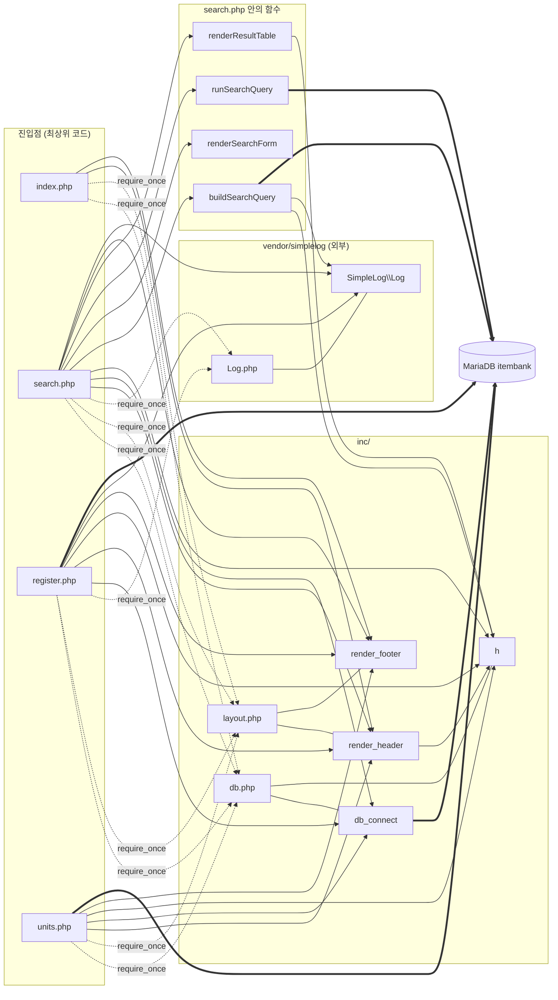

# 문항 은행(레거시 PHP) 구조 분석

대상: `legacy/item-bank-php` · 분석일: 2026-10-07 · 근거 표기는 저장소 루트 기준 `파일:줄번호`이다.

## 1. 모듈 개요

- PHP 7.4 + Apache 이미지 위에서 mysqli로 MariaDB에 접속하는 화면 4개(홈 · 검색 · 등록 · 단원 목록)짜리 모듈이다 (`legacy/item-bank-php/Dockerfile:1-3`, `legacy/item-bank-php/inc/layout.php:9-13`).
- 라우터 · 프레임워크 없이 최상위 `.php` 파일이 곧 진입점이며, 각 파일이 `require_once`로 공통 파일을 직접 읽는다 (`legacy/item-bank-php/index.php:2-3`).
- 공통 코드는 `inc/db.php`(연결 · 이스케이프)와 `inc/layout.php`(머리말 · 꼬리말) 두 파일이다 (`legacy/item-bank-php/inc/db.php:7`, `legacy/item-bank-php/inc/db.php:34`, `legacy/item-bank-php/inc/layout.php:7`, `legacy/item-bank-php/inc/layout.php:38`).
- 외부 라이브러리는 `vendor/simplelog/Log.php` 하나이고 검색 · 등록 화면만 사용한다 (`legacy/item-bank-php/search.php:22`, `legacy/item-bank-php/register.php:4`).
- 자체 함수는 8개이고, 로직 대부분은 `search.php`의 `buildSearchQuery` 한 함수에 있다 (`legacy/item-bank-php/search.php:42-564`).

## 2. 분석 범위와 건너뛴 폴더

| 구분 | 대상 | 처리 |
|---|---|---|
| 전체를 열어 읽음 | `legacy/item-bank-php/index.php`, `search.php`, `register.php`, `units.php`, `inc/db.php`, `inc/layout.php`, `Dockerfile` | 1줄부터 끝까지 확인 |
| 본문을 읽지 않음 | `legacy/item-bank-php/vendor/simplelog/Log.php` | 외부 라이브러리. 선언부(namespace · class · 상수 · 메서드 시그니처)와 `error_log` 호출 위치만 패턴 검색으로 확인하고, 메서드 본문은 읽지 않았다 |
| 폴더 밖 참조(존재 확인만) | `docker-compose.yml`, `db/mariadb/init/01-schema.sql` | 포트 · 환경 변수 · 테이블/뷰 선언 줄만 확인. 스키마 본문은 분석 범위 밖 |
| 빌드 산출물 | 없음 | 폴더 안에서 발견되지 않았다 |

- 폴더 안의 파일은 위 8개가 전부이다. 숨김 파일(`.htaccess` 등)은 검색했으나 없었다.
- `vendor/simplelog/Log.php:3`에 "외부 라이브러리(더미). 수정하지 말 것"이라는 주석이 있다.

## 3. 폴더 구조

```
legacy/item-bank-php/
├── Dockerfile              php:7.4-apache 이미지, mysqli 설치, 소스 전체를 /var/www/html 로 복사
├── index.php               홈(메뉴) 화면
├── search.php              문항 검색 화면 + 검색 전용 함수 4개
├── register.php            문항 등록 화면 (함수 선언 없음, 최상위 코드만)
├── units.php               단원 목록 화면 (함수 선언 없음, 최상위 코드만)
├── inc/
│   ├── db.php              db_connect(), h()
│   └── layout.php          render_header(), render_footer()
└── vendor/
    └── simplelog/
        └── Log.php         SimpleLog\Log (외부 라이브러리)
```

| 파일 | 줄 수 | 선언된 자체 함수 | 근거 |
|---|---|---|---|
| `index.php` | 14 | 없음 | `legacy/item-bank-php/index.php:1-14` |
| `search.php` | 731 | `buildSearchQuery`, `runSearchQuery`, `renderSearchForm`, `renderResultTable` | `legacy/item-bank-php/search.php:42`, `legacy/item-bank-php/search.php:571`, `legacy/item-bank-php/search.php:629`, `legacy/item-bank-php/search.php:647` |
| `register.php` | 177 | 없음 | `legacy/item-bank-php/register.php:1-177` |
| `units.php` | 48 | 없음 | `legacy/item-bank-php/units.php:1-48` |
| `inc/db.php` | 37 | `db_connect`, `h` | `legacy/item-bank-php/inc/db.php:7`, `legacy/item-bank-php/inc/db.php:34` |
| `inc/layout.php` | 43 | `render_header`, `render_footer` | `legacy/item-bank-php/inc/layout.php:7`, `legacy/item-bank-php/inc/layout.php:38` |

## 4. 진입점

배포 기준: 소스 전체가 `/var/www/html/`로 복사되고(`legacy/item-bank-php/Dockerfile:14`), 컨테이너 80 포트가 호스트 8081로 연결된다(`legacy/item-bank-php/Dockerfile:16`, `docker-compose.yml:38-39`). 아래 URL의 호스트 부분은 이 설정에서 나온 것이다.

| URL | 메서드 | 처음 실행 파일 | 최상위 코드가 직접 호출하는 주요 함수 | 근거 |
|---|---|---|---|---|
| `http://localhost:8081/index.php` | 구분 없음 | `legacy/item-bank-php/index.php` | `render_header` → (정적 HTML) → `render_footer` | `legacy/item-bank-php/index.php:5`, `legacy/item-bank-php/index.php:7-12`, `legacy/item-bank-php/index.php:14` |
| `http://localhost:8081/search.php` | 구분 없음, 입력은 `$_GET` | `legacy/item-bank-php/search.php` | `Log::setThreshold` → `render_header` → `db_connect` → `buildSearchQuery` → `renderSearchForm` → `runSearchQuery` → `renderResultTable` → `render_footer` | `legacy/item-bank-php/search.php:27`, `legacy/item-bank-php/search.php:709`, `legacy/item-bank-php/search.php:713`, `legacy/item-bank-php/search.php:722-725`, `legacy/item-bank-php/search.php:731` |
| `http://localhost:8081/register.php` | GET은 폼 표시, POST는 검증 · 저장 | `legacy/item-bank-php/register.php` | `db_connect` → (POST일 때 검증 · INSERT, `Log::info`/`Log::error`) → `render_header` → `render_footer` | `legacy/item-bank-php/register.php:17`, `legacy/item-bank-php/register.php:40`, `legacy/item-bank-php/register.php:85-123`, `legacy/item-bank-php/register.php:127`, `legacy/item-bank-php/register.php:177` |
| `http://localhost:8081/units.php` | 구분 없음 | `legacy/item-bank-php/units.php` | `render_header` → `db_connect` → (집계 조회 · 표 출력) → `render_footer` | `legacy/item-bank-php/units.php:5`, `legacy/item-bank-php/units.php:8`, `legacy/item-bank-php/units.php:20`, `legacy/item-bank-php/units.php:48` |

- 화면 간 이동은 링크로만 연결된다: 머리말 메뉴(`legacy/item-bank-php/inc/layout.php:9-13`, `legacy/item-bank-php/inc/layout.php:30-34`), 홈 메뉴(`legacy/item-bank-php/index.php:9-11`), 검색 폼 · 정렬 · 페이지 링크(`legacy/item-bank-php/search.php:632`, `legacy/item-bank-php/search.php:414`, `legacy/item-bank-php/search.php:430`), 등록 폼(`legacy/item-bank-php/register.php:141`).
- `search.php`와 `units.php`는 요청 메서드를 검사하지 않는다. `register.php`만 `$_SERVER['REQUEST_METHOD']`를 본다 (`legacy/item-bank-php/register.php:40`).
- 진입점 4개는 모두 파일 최상위 코드로 실행되며, 이 코드를 감싸는 함수는 없다. 이 문서에서는 "`파일명` 최상위 코드"로만 부른다.
- `inc/`와 `vendor/`도 같은 문서 루트에 복사된다(`legacy/item-bank-php/Dockerfile:14`). `inc/db.php`와 `inc/layout.php`는 함수 선언만 있고 최상위 실행문이 없다 (`legacy/item-bank-php/inc/db.php:7-37`, `legacy/item-bank-php/inc/layout.php:7-43`). 직접 URL 접근을 막는 설정은 폴더 안에서 발견되지 않았다.

## 5. 의존 관계

### 5.1 흐름도

점선은 include(`require_once`, 파일을 읽어 들이는 방향), 실선은 함수 · 메서드 호출 방향, 굵은 선은 SQL 실행이다.



(`DBF --- DBC`처럼 화살표 없는 선은 "이 파일에 선언되어 있음"을 뜻한다.)

### 5.2 include 표 (파일 → 파일)

| 읽는 파일 | 읽히는 파일 | 근거 |
|---|---|---|
| `index.php` | `inc/db.php` | `legacy/item-bank-php/index.php:2` |
| `index.php` | `inc/layout.php` | `legacy/item-bank-php/index.php:3` |
| `search.php` | `inc/db.php` | `legacy/item-bank-php/search.php:20` |
| `search.php` | `inc/layout.php` | `legacy/item-bank-php/search.php:21` |
| `search.php` | `vendor/simplelog/Log.php` | `legacy/item-bank-php/search.php:22` (`use`는 `legacy/item-bank-php/search.php:24`) |
| `register.php` | `inc/db.php` | `legacy/item-bank-php/register.php:2` |
| `register.php` | `inc/layout.php` | `legacy/item-bank-php/register.php:3` |
| `register.php` | `vendor/simplelog/Log.php` | `legacy/item-bank-php/register.php:4` (`use`는 `legacy/item-bank-php/register.php:6`) |
| `units.php` | `inc/db.php` | `legacy/item-bank-php/units.php:2` |
| `units.php` | `inc/layout.php` | `legacy/item-bank-php/units.php:3` |

- include는 모두 진입점 → 공통 파일 한 방향이다. `inc/db.php`, `inc/layout.php` 안에는 include 문이 없다 (`legacy/item-bank-php/inc/db.php:1-37`, `legacy/item-bank-php/inc/layout.php:1-43`).
- `inc/layout.php`의 `render_header`는 `inc/db.php`에 선언된 `h`를 호출하지만(`legacy/item-bank-php/inc/layout.php:17`, `legacy/item-bank-php/inc/layout.php:33`) `layout.php`가 `db.php`를 읽지는 않는다. 진입점이 두 파일을 함께 읽기 때문에 동작하는 암묵적 의존이다.
- `index.php`는 `inc/db.php`를 읽지만 `db_connect`를 호출하지 않는다 (`legacy/item-bank-php/index.php:2`, `legacy/item-bank-php/index.php:5-14`). `h`만 `render_header`를 거쳐 간접 사용된다.
- 진입점끼리 서로 include하지 않는다. 자동 로더(`autoload`) 사용도 없다.

### 5.3 함수 호출 표 (호출하는 쪽 → 호출되는 쪽)

| 호출하는 쪽 | 호출되는 쪽 | 선언 위치 | 호출 근거 |
|---|---|---|---|
| `index.php` 최상위 코드 | `render_header` | `legacy/item-bank-php/inc/layout.php:7` | `legacy/item-bank-php/index.php:5` |
| `index.php` 최상위 코드 | `render_footer` | `legacy/item-bank-php/inc/layout.php:38` | `legacy/item-bank-php/index.php:14` |
| `units.php` 최상위 코드 | `render_header` | `legacy/item-bank-php/inc/layout.php:7` | `legacy/item-bank-php/units.php:5` |
| `units.php` 최상위 코드 | `db_connect` | `legacy/item-bank-php/inc/db.php:7` | `legacy/item-bank-php/units.php:8` |
| `units.php` 최상위 코드 | `h` | `legacy/item-bank-php/inc/db.php:34` | `legacy/item-bank-php/units.php:10`, `legacy/item-bank-php/units.php:40-43` |
| `units.php` 최상위 코드 | `render_footer` | `legacy/item-bank-php/inc/layout.php:38` | `legacy/item-bank-php/units.php:11`, `legacy/item-bank-php/units.php:23`, `legacy/item-bank-php/units.php:48` |
| `register.php` 최상위 코드 | `db_connect` | `legacy/item-bank-php/inc/db.php:7` | `legacy/item-bank-php/register.php:17` |
| `register.php` 최상위 코드 | `render_header` | `legacy/item-bank-php/inc/layout.php:7` | `legacy/item-bank-php/register.php:19`, `legacy/item-bank-php/register.php:127` |
| `register.php` 최상위 코드 | `h` | `legacy/item-bank-php/inc/db.php:34` | `legacy/item-bank-php/register.php:20`, `legacy/item-bank-php/register.php:131`, `legacy/item-bank-php/register.php:136`, `legacy/item-bank-php/register.php:144`, `legacy/item-bank-php/register.php:148`, `legacy/item-bank-php/register.php:155`, `legacy/item-bank-php/register.php:171` |
| `register.php` 최상위 코드 | `render_footer` | `legacy/item-bank-php/inc/layout.php:38` | `legacy/item-bank-php/register.php:21`, `legacy/item-bank-php/register.php:177` |
| `register.php` 최상위 코드 | `Log::info` (외부) | `legacy/item-bank-php/vendor/simplelog/Log.php:28` | `legacy/item-bank-php/register.php:115` |
| `register.php` 최상위 코드 | `Log::error` (외부) | `legacy/item-bank-php/vendor/simplelog/Log.php:38` | `legacy/item-bank-php/register.php:121` |
| `search.php` 최상위 코드 | `Log::setThreshold` (외부) | `legacy/item-bank-php/vendor/simplelog/Log.php:18` | `legacy/item-bank-php/search.php:27` |
| `search.php` 최상위 코드 | `render_header` | `legacy/item-bank-php/inc/layout.php:7` | `legacy/item-bank-php/search.php:709` |
| `search.php` 최상위 코드 | `db_connect` | `legacy/item-bank-php/inc/db.php:7` | `legacy/item-bank-php/search.php:713` |
| `search.php` 최상위 코드 | `h` | `legacy/item-bank-php/inc/db.php:34` | `legacy/item-bank-php/search.php:715` |
| `search.php` 최상위 코드 | `buildSearchQuery` | `legacy/item-bank-php/search.php:42` | `legacy/item-bank-php/search.php:722` |
| `search.php` 최상위 코드 | `renderSearchForm` | `legacy/item-bank-php/search.php:629` | `legacy/item-bank-php/search.php:723` |
| `search.php` 최상위 코드 | `runSearchQuery` | `legacy/item-bank-php/search.php:571` | `legacy/item-bank-php/search.php:724` |
| `search.php` 최상위 코드 | `renderResultTable` | `legacy/item-bank-php/search.php:647` | `legacy/item-bank-php/search.php:725` |
| `search.php` 최상위 코드 | `Log::error` (외부) | `legacy/item-bank-php/vendor/simplelog/Log.php:38` | `legacy/item-bank-php/search.php:727` |
| `search.php` 최상위 코드 | `render_footer` | `legacy/item-bank-php/inc/layout.php:38` | `legacy/item-bank-php/search.php:717`, `legacy/item-bank-php/search.php:731` |
| `buildSearchQuery` | `h` | `legacy/item-bank-php/inc/db.php:34` | `legacy/item-bank-php/search.php:360`, `legacy/item-bank-php/search.php:365`, `legacy/item-bank-php/search.php:416`, `legacy/item-bank-php/search.php:455-459`, `legacy/item-bank-php/search.php:468-470`, `legacy/item-bank-php/search.php:478-480`, `legacy/item-bank-php/search.php:487-489`, `legacy/item-bank-php/search.php:494`, `legacy/item-bank-php/search.php:499`, `legacy/item-bank-php/search.php:502`, `legacy/item-bank-php/search.php:513` |
| `buildSearchQuery` | `Log::debug` (외부) | `legacy/item-bank-php/vendor/simplelog/Log.php:23` | `legacy/item-bank-php/search.php:103`, `legacy/item-bank-php/search.php:528` |
| `buildSearchQuery` | `Log::error` (외부) | `legacy/item-bank-php/vendor/simplelog/Log.php:38` | `legacy/item-bank-php/search.php:537` |
| `renderResultTable` | `h` | `legacy/item-bank-php/inc/db.php:34` | `legacy/item-bank-php/search.php:674-678`, `legacy/item-bank-php/search.php:690`, `legacy/item-bank-php/search.php:696`, `legacy/item-bank-php/search.php:700` |
| `render_header` | `h` | `legacy/item-bank-php/inc/db.php:34` | `legacy/item-bank-php/inc/layout.php:17`, `legacy/item-bank-php/inc/layout.php:33` |

- `runSearchQuery`, `renderSearchForm`, `render_footer`, `db_connect`, `h`는 다른 자체 함수를 호출하지 않는다 (`legacy/item-bank-php/search.php:571-624`, `legacy/item-bank-php/search.php:629-641`, `legacy/item-bank-php/inc/layout.php:38-43`, `legacy/item-bank-php/inc/db.php:7-29`, `legacy/item-bank-php/inc/db.php:34-37`).
- `search.php`의 함수 4개는 서로 호출하지 않고, 최상위 코드가 순서대로 호출하며 반환 배열(`$built`, `$result`)을 넘긴다 (`legacy/item-bank-php/search.php:722-725`).
- 자체 코드가 호출하는 외부 라이브러리 메서드는 `setThreshold`, `debug`, `info`, `error` 4개와 상수 `Log::LEVEL_INFO`(`legacy/item-bank-php/search.php:27`, 선언 `legacy/item-bank-php/vendor/simplelog/Log.php:12`)이다. `Log::warn`(`legacy/item-bank-php/vendor/simplelog/Log.php:33`)은 선언만 있고 자체 코드에서 호출하지 않는다.

### 5.4 DB 접근 (어느 코드가 어떤 객체를 쓰는가)

| 접근하는 코드 | 대상 | 종류 | 근거 |
|---|---|---|---|
| `db_connect` | DB 연결 (환경 변수 `DB_HOST` · `DB_PORT` · `DB_NAME` · `DB_USER` · `DB_PASS`) | `new mysqli`, `set_charset` | `legacy/item-bank-php/inc/db.php:14-18`, `legacy/item-bank-php/inc/db.php:21`, `legacy/item-bank-php/inc/db.php:27` · 환경 변수 주입 `docker-compose.yml:40-45` |
| `buildSearchQuery` | `unit` | SELECT (단원 이름 · 선택 목록) | `legacy/item-bank-php/search.php:125`, `legacy/item-bank-php/search.php:156` |
| `buildSearchQuery` | `tag` | SELECT (선택 목록) | `legacy/item-bank-php/search.php:178` |
| `buildSearchQuery` | `v_item_public`, `item_tag`, `tag` | SQL 문자열 조립만 (실행하지 않음) | `legacy/item-bank-php/search.php:244-245`, `legacy/item-bank-php/search.php:521-526` |
| `runSearchQuery` | 조립된 건수 · 목록 SQL | prepare · execute | `legacy/item-bank-php/search.php:577`, `legacy/item-bank-php/search.php:588`, `legacy/item-bank-php/search.php:600`, `legacy/item-bank-php/search.php:611` |
| `register.php` 최상위 코드 | `unit`, `tag` | SELECT (선택 목록) | `legacy/item-bank-php/register.php:27`, `legacy/item-bank-php/register.php:34` |
| `register.php` 최상위 코드 | `item` | SELECT … FOR UPDATE, INSERT | `legacy/item-bank-php/register.php:87`, `legacy/item-bank-php/register.php:92-99` |
| `register.php` 최상위 코드 | `item_tag` | INSERT | `legacy/item-bank-php/register.php:105-108` |
| `register.php` 최상위 코드 | 트랜잭션 | begin · commit · rollback | `legacy/item-bank-php/register.php:85`, `legacy/item-bank-php/register.php:114`, `legacy/item-bank-php/register.php:120` |
| `units.php` 최상위 코드 | `unit`, `item` | SELECT (단원별 `status = 'A'` 건수) | `legacy/item-bank-php/units.php:16-20` |

- 테이블 · 뷰 선언 위치(폴더 밖, 선언 줄만 확인): `unit` `db/mariadb/init/01-schema.sql:11`, `item` `db/mariadb/init/01-schema.sql:20`, `tag` `db/mariadb/init/01-schema.sql:35`, `item_tag` `db/mariadb/init/01-schema.sql:42`, `v_item_public` `db/mariadb/init/01-schema.sql:52`.
- `index.php`는 DB에 접근하지 않는다 (`legacy/item-bank-php/index.php:1-14`).

## 6. 가장 긴 자체 함수 3개

줄 수는 `function` 선언 줄부터 닫는 중괄호 줄까지이다. 파일 최상위 코드는 함수가 아니므로 대상에서 뺐다.

| 순위 | 함수 | 시작 | 끝 | 줄 수 |
|---|---|---|---|---|
| 1 | `buildSearchQuery` | `legacy/item-bank-php/search.php:42` | `legacy/item-bank-php/search.php:564` | 523 |
| 2 | `renderResultTable` | `legacy/item-bank-php/search.php:647` | `legacy/item-bank-php/search.php:704` | 58 |
| 3 | `runSearchQuery` | `legacy/item-bank-php/search.php:571` | `legacy/item-bank-php/search.php:624` | 54 |

참고로 나머지 자체 함수는 `render_header` 30줄(`legacy/item-bank-php/inc/layout.php:7-36`), `db_connect` 23줄(`legacy/item-bank-php/inc/db.php:7-29`), `renderSearchForm` 13줄(`legacy/item-bank-php/search.php:629-641`), `render_footer` 6줄(`legacy/item-bank-php/inc/layout.php:38-43`), `h` 4줄(`legacy/item-bank-php/inc/db.php:34-37`)이다.

### 6.1 `buildSearchQuery` — `legacy/item-bank-php/search.php:42-564`

`$_GET`과 mysqli 연결을 받아 실행용 SQL · 바인딩과 화면용 HTML 조각을 한 배열로 돌려준다. 한 함수 안에 아래 일이 순서대로 들어 있다.

| 구간 | 하는 일 | 근거 |
|---|---|---|
| 파라미터 꺼내기 | `q` · `unit` · `level` · `tag` · `sort` · `dir` · `page`를 문자열로 정리(배열이면 첫 값) | `legacy/item-bank-php/search.php:53-80` |
| 키워드 | 100자 제한, `title`/`stem` LIKE 조건 추가, `Log::debug` | `legacy/item-bank-php/search.php:85-104` |
| 단원 | 형식 경고, `unit_code = ?` 조건, **DB 조회**로 단원 이름 확인 | `legacy/item-bank-php/search.php:109-147` |
| 선택 목록 | 단원 · 태그 목록을 **DB 조회**, 난이도 목록 생성 | `legacy/item-bank-php/search.php:152-206` |
| 난이도 | 빈값이면 `level < 5`, 1~5면 `level = ?`, 그 밖의 값도 정수로 비교 | `legacy/item-bank-php/search.php:211-230` |
| 태그 | `item_tag` · `tag` EXISTS 조건, 등록된 태그인지 확인 | `legacy/item-bank-php/search.php:235-261` |
| 정렬 | `sort` · `dir`에 따른 ORDER BY 결정 | `legacy/item-bank-php/search.php:266-331` |
| 페이지 | 1~999 범위 보정, 한 페이지 20건 OFFSET | `legacy/item-bank-php/search.php:336-349` |
| 화면용 HTML | 조건 요약, 정렬 링크, 페이지 링크 앞부분, 폼 select · input, 경고 목록 | `legacy/item-bank-php/search.php:354-516` |
| SQL 조립 | `v_item_public` 기준 목록 · 건수 SQL, 바인딩 개수 검사(불일치 시 `RuntimeException`) | `legacy/item-bank-php/search.php:521-539` |
| 반환 | 16개 키를 가진 배열 | `legacy/item-bank-php/search.php:541-563` |

- 이름은 "쿼리 조립"이지만 DB 조회 3건(`legacy/item-bank-php/search.php:125`, `legacy/item-bank-php/search.php:156`, `legacy/item-bank-php/search.php:178`)과 HTML 생성(`legacy/item-bank-php/search.php:354-516`)을 함께 한다. `$conn`이 `null`이면 조회를 건너뛰도록 분기되어 있다 (`legacy/item-bank-php/search.php:124`, `legacy/item-bank-php/search.php:155`, `legacy/item-bank-php/search.php:177`).
- 난이도 빈값 분기의 주석은 "전체 난이도 검색 (1~5 모두 포함)"인데 코드는 `level < 5`이다 (`legacy/item-bank-php/search.php:213-215`). 주석과 코드가 다르다는 사실만 확인했고, 어느 쪽이 의도인지는 미확인이다.

### 6.2 `renderResultTable` — `legacy/item-bank-php/search.php:647-704`

`buildSearchQuery`의 반환 배열과 `runSearchQuery`의 결과를 받아 화면에 출력한다. 반환값은 없다.

- 경고 · 조건 요약 HTML을 그대로 출력하고 건수 문단 `<p id="count">`를 쓴다 (`legacy/item-bank-php/search.php:652-655`).
- 0건이면 `<p id="message">`만 출력하고 끝낸다 (`legacy/item-bank-php/search.php:657-660`).
- 결과 표 `<table id="items">`를 id · title · unit_code · level · tag_names 순으로 출력하며 각 값은 `h`로 이스케이프한다 (`legacy/item-bank-php/search.php:662-681`).
- 총 페이지가 2 이상이면 이전 · 번호 · 다음 링크를 출력한다 (`legacy/item-bank-php/search.php:684-703`).

### 6.3 `runSearchQuery` — `legacy/item-bank-php/search.php:571-624`

조립된 SQL 두 개를 실행해 `array('total' => 건수, 'rows' => 행 배열)`을 돌려준다 (`legacy/item-bank-php/search.php:623`).

- 건수 SQL: prepare → 바인딩 → execute → `cnt` 읽기 (`legacy/item-bank-php/search.php:577-597`).
- 목록 SQL: 같은 절차로 실행해 행을 모은다 (`legacy/item-bank-php/search.php:600-621`).
- 바인딩은 참조 배열을 만들어 `call_user_func_array`로 `bind_param`을 호출하며, 같은 코드가 두 번 반복된다 (`legacy/item-bank-php/search.php:581-587`, `legacy/item-bank-php/search.php:604-610`).
- prepare · execute 실패 시 `RuntimeException`을 던지고(`legacy/item-bank-php/search.php:579`, `legacy/item-bank-php/search.php:589`, `legacy/item-bank-php/search.php:602`, `legacy/item-bank-php/search.php:612`), `search.php` 최상위 코드가 받아 로그와 오류 문구를 낸다 (`legacy/item-bank-php/search.php:726-729`).

## 7. 미확인 목록

| # | 항목 | 확인한 범위 | 확인하지 못한 이유 |
|---|---|---|---|
| 1 | `http://localhost:8081/`(파일명 없는 루트)이 `index.php`를 실행하는지 | 폴더 안에 `DirectoryIndex` 설정 · `.htaccess`가 없음 | 기본 이미지(`legacy/item-bank-php/Dockerfile:1`)의 Apache 설정에 달려 있고 저장소에 없다 |
| 2 | `a2enmod rewrite`의 용도 | 모듈을 켜는 줄만 있음 (`legacy/item-bank-php/Dockerfile:4`). 폴더 안에 rewrite 규칙 파일이 없음 | 규칙이 이미지 밖 다른 곳에 있는지 알 수 없다 |
| 3 | `SimpleLog\Log` 메서드의 실제 동작(출력 형식, 임계값 적용 방식) | 시그니처(`legacy/item-bank-php/vendor/simplelog/Log.php:18`, `legacy/item-bank-php/vendor/simplelog/Log.php:23`, `legacy/item-bank-php/vendor/simplelog/Log.php:28`, `legacy/item-bank-php/vendor/simplelog/Log.php:33`, `legacy/item-bank-php/vendor/simplelog/Log.php:38`, `legacy/item-bank-php/vendor/simplelog/Log.php:43`), 상수(`legacy/item-bank-php/vendor/simplelog/Log.php:11-14`), `error_log` 호출 줄(`legacy/item-bank-php/vendor/simplelog/Log.php:52`) | 외부 라이브러리 본문은 읽지 않았다 |
| 4 | `Log::write`(private, `legacy/item-bank-php/vendor/simplelog/Log.php:43`)를 어느 메서드가 호출하는지, `legacy/item-bank-php/vendor/simplelog/Log.php:52`의 `error_log`가 어느 메서드 안에 있는지 | 선언 줄과 호출 줄 번호 | 위와 같음 |
| 5 | `vendor/simplelog/Log.php`를 URL로 직접 열었을 때 실행되는 최상위 코드가 있는지 | include 문 · 추가 클래스 선언은 패턴 검색에서 나오지 않음 | 위와 같음 |
| 6 | `register.php`에서 `Log::setThreshold`를 호출하지 않을 때의 기본 임계값 | `register.php`에 `setThreshold` 호출이 없음 (`legacy/item-bank-php/register.php:1-177`) | 기본값은 라이브러리 본문에 있다 |
| 7 | `v_item_public` 뷰의 정의(어떤 상태의 문항을 내보내는지, `tag_names` 생성 방식) | 선언 줄 `db/mariadb/init/01-schema.sql:52`, 사용 줄 `legacy/item-bank-php/search.php:521-522` | 스키마 본문은 분석 범위 밖이라 읽지 않았다 |
| 8 | `item` · `unit` · `tag` · `item_tag`의 컬럼 · 제약, `status` 값 `'R'` · `'A'`의 전체 목록 | 코드에 쓰인 값만 확인 (`legacy/item-bank-php/register.php:94`, `legacy/item-bank-php/units.php:17`) | 위와 같음 |
| 9 | 난이도 빈값 조건 `level < 5`가 의도인지 주석이 맞는지 | 주석과 코드의 불일치 (`legacy/item-bank-php/search.php:213-215`) | 요구사항 문서를 확인하지 않았다 |
| 10 | 실제 실행 시 동작 | 소스 정적 분석만 수행 | 컨테이너를 띄우거나 HTTP 요청을 보내지 않았다 (실행하지 않음) |
| 11 | 이 폴더를 참조하는 다른 모듈(`characterization` 등)의 호출 방식 | 폴더 밖에서 경로 문자열이 나오는 곳만 검색 (`docker-compose.yml:36`, `README.md:13`, `README.md:85`) | 요청 범위가 `legacy/item-bank-php`의 진입점 · 의존 관계이다 |

## 8. 후속 검증 이력

- 2026-10-07: PHP tokenizer로 자체 함수 8개의 실제 시작·끝을 확인했다. 최장 함수 3개는 buildSearchQuery(42~564, 523줄), renderResultTable(647~704, 58줄), runSearchQuery(571~624, 54줄)로 문서와 일치한다.
- 2026-10-07: 검색 진입점의 `legacy/item-bank-php/search.php:722-725`를 직접 열어 조립 → 폼 → 실행 → 결과 출력 순서를 확인했다.
- 2026-10-07: 루트·단원 목록·등록 폼·검색의 HTTP 응답을 확인했다. `http://localhost:8081/`는 홈 화면을 반환한다. 검색 조합과 경계값까지 HTTP 12건이 통과했다.
- 7장의 미확인은 초안 시점 기록이다. #1과 #10의 기본 로컬 HTTP 응답은 확인했고, #7·8의 스키마와 데이터 흐름은 후속 ERD 분석에서 확인했다. 기타 외부 라이브러리 구현·요구사항 의도는 미확인으로 유지한다.
