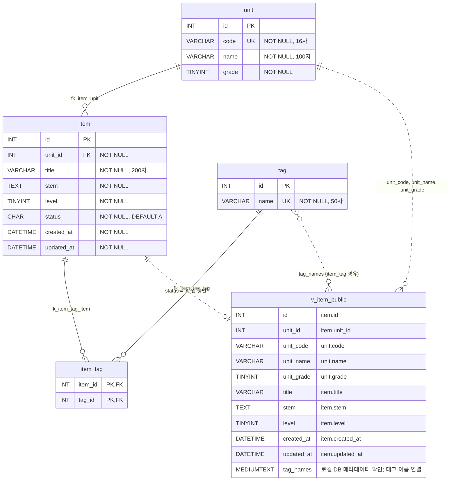

# 문항 은행(레거시 PHP) ERD

대상: `legacy/item-bank-php`가 실제로 쓰는 테이블 4개와 뷰 1개 · 분석일: 2026-10-07 · 근거 표기는 저장소 루트 기준 `파일:줄번호`이다.

- 읽은 파일: `db/mariadb/init/01-schema.sql` 전체, `legacy/item-bank-php`의 `index.php` · `search.php` · `register.php` · `units.php` · `inc/db.php` · `inc/layout.php` 전체, `docs/item-bank/ARCHITECTURE.md`.
- 읽지 않은 파일: `legacy/item-bank-php/vendor/simplelog/Log.php`(외부 라이브러리), `db/mariadb/init`의 다른 파일, 그 밖의 모듈.
- 초안은 정적 분석으로 작성했다. 후속 검증에서 로컬 DB의 INFORMATION_SCHEMA.COLUMNS와 문항 상태 분포를 읽기 전용으로 조회했다.
- 같은 스키마 파일의 `class` · `assignment` · `distribution` · `submission`(`db/mariadb/init/01-schema.sql:75-115`)은 문항 은행 PHP 코드의 SQL에 나오지 않으므로 뺐다. 단, `assignment.unit_id`가 `unit`을 참조한다는 선언은 있다(`db/mariadb/init/01-schema.sql:89`).

## 1. 테이블 · 뷰 목록

| 이름 | 종류 | 주요 컬럼 | 키 · 제약 | 근거 |
|---|---|---|---|---|
| `unit` | 테이블 | `id` INT, `code` VARCHAR(16), `name` VARCHAR(100), `grade` TINYINT — 모두 NOT NULL | PK `id`, UNIQUE `uk_unit_code(code)` | `db/mariadb/init/01-schema.sql:11-18` |
| `item` | 테이블 | `id` INT, `unit_id` INT, `title` VARCHAR(200), `stem` TEXT, `level` TINYINT, `status` CHAR(1) DEFAULT 'A', `created_at` · `updated_at` DATETIME — 모두 NOT NULL | PK `id`, 인덱스 `idx_item_unit(unit_id)` · `idx_item_level(level)`, FK `fk_item_unit` | `db/mariadb/init/01-schema.sql:20-33` |
| `tag` | 테이블 | `id` INT, `name` VARCHAR(50) — 모두 NOT NULL | PK `id`, UNIQUE `uk_tag_name(name)` | `db/mariadb/init/01-schema.sql:35-40` |
| `item_tag` | 테이블 | `item_id` INT, `tag_id` INT — 모두 NOT NULL | 복합 PK `(item_id, tag_id)`, FK `fk_item_tag_item` · `fk_item_tag_tag` | `db/mariadb/init/01-schema.sql:42-48` |
| `v_item_public` | **뷰** | `id`, `unit_id`, `unit_code`, `unit_name`, `unit_grade`, `title`, `stem`, `level`, `created_at`, `updated_at`, `tag_names` | 뷰이므로 자체 키 · 제약 없음 | `db/mariadb/init/01-schema.sql:52-70` |

- `id` 컬럼이 있는 세 테이블(`unit` · `item` · `tag`)에는 `AUTO_INCREMENT`가 없다. `item_tag`에는 `id` 컬럼이 없고 `(item_id, tag_id)` 복합 키를 쓴다(`db/mariadb/init/01-schema.sql:12`, `db/mariadb/init/01-schema.sql:21`, `db/mariadb/init/01-schema.sql:36`). 문항 번호는 등록 코드가 `MAX(id) + 1`로 직접 만든다(`legacy/item-bank-php/register.php:87-90`).
- `CHECK` 제약은 어느 테이블에도 없다(`db/mariadb/init/01-schema.sql:11-48`). `level` 범위와 `status` 값 목록은 DDL이 막지 않는다.
- FK 세 개 모두 `ON DELETE` · `ON UPDATE` 절이 없다(`db/mariadb/init/01-schema.sql:32`, `db/mariadb/init/01-schema.sql:46-47`).

### `v_item_public` 뷰 정의

| 항목 | 내용 | 근거 |
|---|---|---|
| 필터 | `WHERE i.status = 'A'` 하나뿐이다. `level` · 날짜 등 다른 조건은 없다 | `db/mariadb/init/01-schema.sql:70` |
| 기반 테이블 (FROM · JOIN) | `item i` INNER JOIN `unit u ON u.id = i.unit_id` | `db/mariadb/init/01-schema.sql:68-69` |
| 기반 테이블 (스칼라 서브쿼리) | `item_tag it` JOIN `tag t ON t.id = it.tag_id`, 조건 `it.item_id = i.id` | `db/mariadb/init/01-schema.sql:64-67` |
| `item`에서 오는 컬럼 | `id`, `unit_id`, `title`, `stem`, `level`, `created_at`, `updated_at` | `db/mariadb/init/01-schema.sql:54-55`, `db/mariadb/init/01-schema.sql:59-63` |
| `unit`에서 오는 컬럼 | `unit_code`(=`code`), `unit_name`(=`name`), `unit_grade`(=`grade`) | `db/mariadb/init/01-schema.sql:56-58` |
| `tag_names` | 문항에 붙은 `tag.name`을 `tag.id` 순서로 쉼표로 이어 붙인 문자열 | `db/mariadb/init/01-schema.sql:64-67` |
| 내보내지 않는 컬럼 | `item.status` | `db/mariadb/init/01-schema.sql:53-67` |

- 태그가 없는 문항도 뷰에 나온다. 태그는 JOIN이 아니라 SELECT 절의 서브쿼리로 붙기 때문이다(`db/mariadb/init/01-schema.sql:64-67`). 이때 `tag_names`가 `NULL`일 수 있다는 전제로 화면 코드가 빈 문자열 처리를 한다(`legacy/item-bank-php/search.php:678`).
- 뷰를 조회하는 코드가 쓰는 컬럼은 `id`, `title`, `unit_code`, `level`, `tag_names`, `created_at`(SELECT, `legacy/item-bank-php/search.php:521`)과 `stem`(WHERE, `legacy/item-bank-php/search.php:98`)이다. `unit_id`, `unit_name`, `unit_grade`, `updated_at`은 문항 은행 PHP 코드에서 쓰지 않는다.

## 2. ERD

실선은 `FOREIGN KEY`로 선언된 관계, 점선은 선언이 없는 관계(뷰가 기반 테이블에서 행 · 컬럼을 가져오는 관계)이다.



- `v_item_public`의 컬럼 타입은 뷰 정의에 적혀 있지 않다. 그림의 일반 컬럼은 기반 컬럼의 타입을 따른다. `tag_names`는 후속 로컬 DB 메타데이터 조회에서 `mediumtext`, nullable, collation `utf8mb4_unicode_ci`임을 확인했다. 다른 DB 버전·설정에서도 같은 타입인지는 별도 검증하지 않았다.

## 3. 관계 표

### 3.1 FOREIGN KEY로 선언된 관계 (확인된 사실)

| # | 자식 → 부모 | 제약 이름 | 카디널리티 | 필수 여부 | DDL 근거 |
|---|---|---|---|---|---|
| F1 | `item.unit_id` → `unit.id` | `fk_item_unit` | 단원 1 : 문항 0..N | 문항 쪽 필수(문항은 단원이 꼭 1개), 단원 쪽 선택(문항 0개인 단원 가능) | FK `db/mariadb/init/01-schema.sql:32` · `unit_id NOT NULL` `db/mariadb/init/01-schema.sql:22` · 부모 PK `db/mariadb/init/01-schema.sql:16` · `unit_id`에 UNIQUE 없음(일반 인덱스 `db/mariadb/init/01-schema.sql:30`) |
| F2 | `item_tag.item_id` → `item.id` | `fk_item_tag_item` | 문항 1 : 연결 행 0..N | 연결 행 쪽 필수, 문항 쪽 선택(태그 0개인 문항 가능) | FK `db/mariadb/init/01-schema.sql:46` · `item_id NOT NULL` `db/mariadb/init/01-schema.sql:43` · 부모 PK `db/mariadb/init/01-schema.sql:29` |
| F3 | `item_tag.tag_id` → `tag.id` | `fk_item_tag_tag` | 태그 1 : 연결 행 0..N | 연결 행 쪽 필수, 태그 쪽 선택(쓰이지 않는 태그 가능) | FK `db/mariadb/init/01-schema.sql:47` · `tag_id NOT NULL` `db/mariadb/init/01-schema.sql:44` · 부모 PK `db/mariadb/init/01-schema.sql:38` |

- F2 + F3으로 `item` : `tag`는 N:M이다. 복합 PK `(item_id, tag_id)`(`db/mariadb/init/01-schema.sql:45`) 때문에 같은 문항 · 같은 태그 쌍은 한 번만 들어갈 수 있다.
- "0개 가능"은 DDL에 최소 개수를 강제하는 제약이 없다는 뜻이다. 코드에서도 태그 없이 문항만 넣는 경로가 있다(`legacy/item-bank-php/register.php:104`).
- `ON DELETE` · `ON UPDATE` 절이 없으므로(`db/mariadb/init/01-schema.sql:32`, `db/mariadb/init/01-schema.sql:46-47`) 삭제 · 변경 시 동작은 DB 기본값을 따른다. 기본값이 실제로 어떻게 동작하는지는 실행해 보지 않았다(미확인 #8).

### 3.2 JOIN · 조건식으로 추정한 관계

FK 선언이 없거나, 선언은 있지만 실행 SQL에서 어떻게 쓰이는지를 따로 확인한 관계이다.

| # | 관계 | 조인 · 조건식 | FK 선언과의 대응 | 근거 |
|---|---|---|---|---|
| J1 | `v_item_public.id` = `item.id` (문항 1 : 뷰 행 0..1) | 뷰가 `item`에서 `status = 'A'`인 행만 내보냄 | 선언 없음(뷰). `item` ↔ `unit` 조인이 INNER이지만 F1과 `unit_id NOT NULL`로 단원이 꼭 1개이므로 행이 늘거나 줄지 않는다고 **추정** | `db/mariadb/init/01-schema.sql:68-70`, `db/mariadb/init/01-schema.sql:22`, `db/mariadb/init/01-schema.sql:32` |
| J2 | `v_item_public.unit_code` ↔ `unit.code` | 뷰 컬럼 별칭 `u.code AS unit_code`, 검색 조건 `unit_code = ?`, 단원 이름 확인 `unit WHERE code = ?` | 선언 없음. `unit.code`가 UNIQUE라 코드 하나에 단원 1개 | `db/mariadb/init/01-schema.sql:56`, `db/mariadb/init/01-schema.sql:17` · `legacy/item-bank-php/search.php:118`, `legacy/item-bank-php/search.php:125` |
| J3 | `item_tag.item_id` ↔ `v_item_public.id` | 검색의 태그 조건 `EXISTS (… WHERE it.item_id = v_item_public.id AND t.name = ?)` | 선언 없음(뷰 대상). J1을 거치면 F2와 같은 관계 | `legacy/item-bank-php/search.php:244-245` |
| J4 | `item_tag.tag_id` ↔ `tag.id` | `JOIN tag t ON t.id = it.tag_id` (뷰의 서브쿼리, 검색의 EXISTS 두 곳) | F3과 일치 | `db/mariadb/init/01-schema.sql:66` · `legacy/item-bank-php/search.php:244` |
| J5 | `item.unit_id` ↔ `unit.id` | 뷰의 `JOIN unit u ON u.id = i.unit_id`, 단원 목록의 `WHERE i.unit_id = u.id` | F1과 일치 | `db/mariadb/init/01-schema.sql:69` · `legacy/item-bank-php/units.php:17` |
| J6 | `v_item_public.tag_names` ↔ `tag.name` (뷰 행 0..N : 태그 0..N) | `GROUP_CONCAT(t.name …)` | 선언 없음. F2 + F3의 N:M을 문자열 하나로 합친 결과 | `db/mariadb/init/01-schema.sql:64-67` |

- 실행 SQL에 나오는 조인 조건 중 FK 선언과 어긋나는 것은 없다(J4 · J5).
- 검색 화면은 태그를 이름(`tag.name`)으로, 등록 화면은 번호(`tag.id`)로 다룬다(`legacy/item-bank-php/search.php:245`, `legacy/item-bank-php/register.php:105-107`). `tag.name`이 UNIQUE(`db/mariadb/init/01-schema.sql:39`)라 이름 하나에 태그 1개이다.

## 4. 테이블별 읽기 · 쓰기 위치

- "최상위 코드"는 함수로 감싸지 않은 파일 최상위 실행문이다.
- `search.php`의 목록 · 건수 SQL은 `buildSearchQuery`가 문자열로 조립만 하고(`legacy/item-bank-php/search.php:521-526`), 실행은 `runSearchQuery`가 한다(건수 `legacy/item-bank-php/search.php:577`, `legacy/item-bank-php/search.php:588` · 목록 `legacy/item-bank-php/search.php:600`, `legacy/item-bank-php/search.php:611`). 아래 표에서는 "조립 / 실행"으로 나눠 적었다.
- 문항 은행 PHP 코드에는 `UPDATE` · `DELETE` 문이 하나도 없다. SQL은 아래 표에 적은 9곳이 전부이다(`legacy/item-bank-php/search.php:125`, `legacy/item-bank-php/search.php:156`, `legacy/item-bank-php/search.php:178`, `legacy/item-bank-php/search.php:244-245`, `legacy/item-bank-php/search.php:521-526` · `legacy/item-bank-php/register.php:27`, `legacy/item-bank-php/register.php:34`, `legacy/item-bank-php/register.php:87`, `legacy/item-bank-php/register.php:93-94`, `legacy/item-bank-php/register.php:105` · `legacy/item-bank-php/units.php:16-19`). `index.php` · `inc/db.php` · `inc/layout.php`에는 SQL이 없다(`legacy/item-bank-php/index.php:1-14`, `legacy/item-bank-php/inc/db.php:1-37`, `legacy/item-bank-php/inc/layout.php:1-43`).

### 4.1 `unit`

| 종류 | 파일 | 함수 / 최상위 코드 | 내용 | 근거 |
|---|---|---|---|---|
| SELECT | `search.php` | `buildSearchQuery` (조립 · 실행 모두) | `name`, `grade`를 `code = ?`로 조회. `unit` 파라미터가 있을 때만 | `legacy/item-bank-php/search.php:125-131` |
| SELECT | `search.php` | `buildSearchQuery` (조립 · 실행 모두) | `code`, `name`, `grade` 전체를 학년 · 코드 순으로 조회(선택 목록) | `legacy/item-bank-php/search.php:156` |
| SELECT | `register.php` | 최상위 코드 | `id`, `code`, `name` 전체 조회(선택 목록 · 단원 검증용) | `legacy/item-bank-php/register.php:27`, `legacy/item-bank-php/register.php:61-65` |
| SELECT | `units.php` | 최상위 코드 | `id`, `code`, `name`, `grade` 전체 조회 | `legacy/item-bank-php/units.php:16-20` |
| SELECT (뷰 경유) | `search.php` | `buildSearchQuery` 조립 / `runSearchQuery` 실행 | `v_item_public`의 `unit_code` | `db/mariadb/init/01-schema.sql:56`, `db/mariadb/init/01-schema.sql:69` · `legacy/item-bank-php/search.php:521-522` |
| INSERT | — | 없음 | — | — |
| UPDATE | — | 없음 | — | — |
| DELETE | — | 없음 | — | — |

### 4.2 `item`

| 종류 | 파일 | 함수 / 최상위 코드 | 내용 | 근거 |
|---|---|---|---|---|
| SELECT | `register.php` | 최상위 코드 (POST · 검증 통과 시, 트랜잭션 안) | `COALESCE(MAX(id), 0) + 1` … `FOR UPDATE`로 새 번호 계산 | `legacy/item-bank-php/register.php:85-90` |
| SELECT | `units.php` | 최상위 코드 | 단원별 `status = 'A'` 건수(상관 서브쿼리) | `legacy/item-bank-php/units.php:17` |
| SELECT (뷰 경유) | `search.php` | `buildSearchQuery` 조립 / `runSearchQuery` 실행 | `v_item_public`으로 건수 · 목록 조회 | `legacy/item-bank-php/search.php:521-526`, `legacy/item-bank-php/search.php:588`, `legacy/item-bank-php/search.php:611` |
| INSERT | `register.php` | 최상위 코드 (POST · 검증 통과 시, 트랜잭션 안) | `id`, `unit_id`, `title`, `stem`, `level` 바인딩, `status`는 리터럴 `'R'`, `created_at` · `updated_at`은 `NOW()` | `legacy/item-bank-php/register.php:92-99` |
| UPDATE | — | 없음 | — | — |
| DELETE | — | 없음 | — | — |

### 4.3 `tag`

| 종류 | 파일 | 함수 / 최상위 코드 | 내용 | 근거 |
|---|---|---|---|---|
| SELECT | `search.php` | `buildSearchQuery` (조립 · 실행 모두) | `name` 전체를 `id` 순으로 조회(선택 목록) | `legacy/item-bank-php/search.php:178` |
| SELECT | `search.php` | `buildSearchQuery` 조립 / `runSearchQuery` 실행 | EXISTS 서브쿼리에서 `t.name = ?`. `tag` 파라미터가 있을 때만 | `legacy/item-bank-php/search.php:236`, `legacy/item-bank-php/search.php:244-245` |
| SELECT | `register.php` | 최상위 코드 | `id`, `name` 전체 조회(체크박스 · 태그 검증용) | `legacy/item-bank-php/register.php:34`, `legacy/item-bank-php/register.php:75-81` |
| SELECT (뷰 경유) | `search.php` | `buildSearchQuery` 조립 / `runSearchQuery` 실행 | `v_item_public.tag_names` | `db/mariadb/init/01-schema.sql:64-67` · `legacy/item-bank-php/search.php:521` |
| INSERT | — | 없음 | — | — |
| UPDATE | — | 없음 | — | — |
| DELETE | — | 없음 | — | — |

### 4.4 `item_tag`

| 종류 | 파일 | 함수 / 최상위 코드 | 내용 | 근거 |
|---|---|---|---|---|
| SELECT | `search.php` | `buildSearchQuery` 조립 / `runSearchQuery` 실행 | EXISTS 서브쿼리에서 `it.item_id = v_item_public.id`. `tag` 파라미터가 있을 때만 | `legacy/item-bank-php/search.php:236`, `legacy/item-bank-php/search.php:244-245` |
| SELECT (뷰 경유) | `search.php` | `buildSearchQuery` 조립 / `runSearchQuery` 실행 | `v_item_public.tag_names` | `db/mariadb/init/01-schema.sql:65-67` · `legacy/item-bank-php/search.php:521` |
| INSERT | `register.php` | 최상위 코드 (POST · 검증 통과 · 유효한 태그가 1개 이상일 때, `item` INSERT와 같은 트랜잭션) | 태그마다 `(item_id, tag_id)` 한 행 | `legacy/item-bank-php/register.php:104-113` |
| UPDATE | — | 없음 | — | — |
| DELETE | — | 없음 | — | — |

### 4.5 `v_item_public` (뷰)

| 종류 | 파일 | 함수 / 최상위 코드 | 내용 | 근거 |
|---|---|---|---|---|
| SELECT (건수) | `search.php` | `buildSearchQuery` 조립 / `runSearchQuery` 실행 | `SELECT COUNT(*) AS cnt FROM v_item_public` + 조건 | 조립 `legacy/item-bank-php/search.php:522`, `legacy/item-bank-php/search.php:526` · 실행 `legacy/item-bank-php/search.php:577`, `legacy/item-bank-php/search.php:588` |
| SELECT (목록) | `search.php` | `buildSearchQuery` 조립 / `runSearchQuery` 실행 | `id`, `title`, `unit_code`, `level`, `tag_names`, `created_at` + 조건 · 정렬 · `LIMIT 20 OFFSET n` | 조립 `legacy/item-bank-php/search.php:521-525` · 실행 `legacy/item-bank-php/search.php:600`, `legacy/item-bank-php/search.php:611` |
| INSERT · UPDATE · DELETE | — | 없음 | — | — |

- 뷰에 붙는 조건은 `title`/`stem` LIKE(`legacy/item-bank-php/search.php:98`), `unit_code = ?`(`legacy/item-bank-php/search.php:118`), `level < 5` 또는 `level = ?`(`legacy/item-bank-php/search.php:215`, `legacy/item-bank-php/search.php:218`, `legacy/item-bank-php/search.php:226`), 태그 EXISTS(`legacy/item-bank-php/search.php:244-245`)이다.
- `units.php`와 `register.php`는 뷰를 쓰지 않는다. `units.php`는 `item`에 `status = 'A'`를 직접 건다(`legacy/item-bank-php/units.php:17`).

### 4.6 데이터 흐름 요약

- **등록**: `register.php` 최상위 코드가 `unit` · `tag` 목록을 읽어 입력을 검증하고(`legacy/item-bank-php/register.php:27`, `legacy/item-bank-php/register.php:34`, `legacy/item-bank-php/register.php:61-81`), 한 트랜잭션 안에서 `item` 번호 계산 → `item` INSERT(`status = 'R'`) → `item_tag` INSERT를 한다(`legacy/item-bank-php/register.php:85-114`). 실패하면 rollback한다(`legacy/item-bank-php/register.php:119-120`).
- **검색**: `v_item_public`만 조회하므로 `status = 'A'`인 문항만 나온다(`legacy/item-bank-php/search.php:522`, `db/mariadb/init/01-schema.sql:70`). 방금 등록한 `'R'` 문항은 나오지 않는다.
- **단원 목록**: `unit` 전체와 단원별 `status = 'A'` 문항 수를 낸다(`legacy/item-bank-php/units.php:16-19`).
- `'R'`을 `'A'`로 바꾸는 SQL은 이 모듈에 없다(미확인 #1).

## 5. 스키마 · 코드 주석과 실행 SQL 대조

| # | 주석 | 실행 SQL · DDL에서 확인한 내용 | 판정 |
|---|---|---|---|
| C1 | `level` — "1~5" (`db/mariadb/init/01-schema.sql:25`) | DDL은 `TINYINT NOT NULL`뿐이고 범위 제약이 없다(`db/mariadb/init/01-schema.sql:25`). 1~5 검사는 등록 화면 코드에만 있다(`legacy/item-bank-php/register.php:70`) | DB는 강제하지 않음 |
| C2 | `status` — "A=공개 D=삭제 R=검수중" (`db/mariadb/init/01-schema.sql:26`) | 값 목록 제약이 없다(`db/mariadb/init/01-schema.sql:26`). 코드가 쓰는 값은 `'R'`(`legacy/item-bank-php/register.php:94`), 읽는 값은 `'A'`(`db/mariadb/init/01-schema.sql:70`, `legacy/item-bank-php/units.php:17`)뿐이다. `'D'`는 문항 은행 PHP 코드의 SQL에 나오지 않는다 | `'D'`는 주석에만 있음 |
| C3 | `status` 기본값 `'A'` (`db/mariadb/init/01-schema.sql:26`) | 유일한 INSERT가 `'R'`을 명시하므로 기본값이 적용되는 경로가 이 모듈에 없다(`legacy/item-bank-php/register.php:93-94`) | 이 모듈에서는 쓰이지 않음 |
| C4 | "노출 여부는 삭제 플래그가 아니라 status 코드로 판정한다" (`db/mariadb/init/01-schema.sql:50`) | 뷰 필터가 `i.status = 'A'`이고(`db/mariadb/init/01-schema.sql:70`), `item`에 삭제 플래그 컬럼이 없다(`db/mariadb/init/01-schema.sql:21-28`) | 일치 |
| C5 | "검색 화면 search.php 와 등록 화면이 모두 이 뷰를 기준으로 삼는다" (`db/mariadb/init/01-schema.sql:51`) | `search.php`는 뷰를 조회한다(`legacy/item-bank-php/search.php:522`). `register.php`의 SQL 5개(`legacy/item-bank-php/register.php:27`, `legacy/item-bank-php/register.php:34`, `legacy/item-bank-php/register.php:87`, `legacy/item-bank-php/register.php:93`, `legacy/item-bank-php/register.php:105`)는 `unit` · `tag` · `item` · `item_tag`만 쓰고 뷰를 쓰지 않는다 | **불일치** (등록 화면은 뷰를 쓰지 않음) |
| C6 | "등록 직후에는 검수중(R) 상태로 들어간다 → 검수 완료 전까지 검색 화면에 나오지 않는다" (`legacy/item-bank-php/register.php:84`) | INSERT가 `'R'`이고(`legacy/item-bank-php/register.php:94`) 뷰는 `'A'`만 내보낸다(`db/mariadb/init/01-schema.sql:70`) | 일치. 단, "검수 완료" 처리 SQL은 없음(미확인 #1) |
| C7 | "단원별 공개(status='A') 문항 수. 삭제 · 검수중 문항은 세지 않는다" (`legacy/item-bank-php/units.php:15`) | 서브쿼리 조건이 `i.status = 'A'`이다(`legacy/item-bank-php/units.php:17`) | 일치 |
| C8 | "공개 문항 뷰(v_item_public)를 기준으로 조회한다" (`legacy/item-bank-php/search.php:519`) | `FROM v_item_public`(`legacy/item-bank-php/search.php:522`) | 일치 |
| C9 | "난이도 값이 비어 있으면 전체 난이도 검색 (1~5 모두 포함)" (`legacy/item-bank-php/search.php:213`) | 실제 조건은 `level < 5`라 `level = 5`인 문항이 빠진다(`legacy/item-bank-php/search.php:214-215`) | **불일치** (어느 쪽이 의도인지는 미확인 #4) |
| C10 | "01 → 02 → 03 순서로 실행된다" (`db/mariadb/init/01-schema.sql:2`) | 다른 초기화 파일은 읽지 않았다 | 미확인 #2 |

추가로 확인한 DDL과 코드의 길이 · 형식 대응:

- 제목 200자 제한(`legacy/item-bank-php/register.php:52`)은 `title VARCHAR(200)`(`db/mariadb/init/01-schema.sql:23`)과 같다.
- 태그 이름 50자 자르기(`legacy/item-bank-php/search.php:240-241`)는 `name VARCHAR(50)`(`db/mariadb/init/01-schema.sql:37`)과 같다.
- 등록 화면은 POST로 받은 태그 번호의 중복을 걸러내지 않는다(`legacy/item-bank-php/register.php:74-81`). 같은 번호가 두 번 오면 복합 PK(`db/mariadb/init/01-schema.sql:45`) 때문에 두 번째 INSERT가 실패해 전체가 rollback될 것으로 **추정**한다(`legacy/item-bank-php/register.php:108-110`, `legacy/item-bank-php/register.php:119-120`). 실행해 확인하지 않았다.

## 6. 미확인 목록

| # | 항목 | 확인한 범위 | 확인하지 못한 이유 |
|---|---|---|---|
| 1 | `item.status`를 `'R'` → `'A'`(검수 완료) 또는 `'D'`(삭제)로 바꾸는 주체 | 문항 은행 PHP 코드에 `UPDATE` · `DELETE`가 없음(4장) | 다른 모듈 · 수작업 SQL · 시드에 있는지는 범위 밖이라 읽지 않았다 |
| 2 | `unit` · `tag` 행을 넣는 곳, 시드 데이터에 들어 있는 `status` · `level` 값 | 문항 은행 PHP 코드에 두 테이블의 INSERT가 없음(4.1, 4.3). 스키마 주석에 후속 초기화 파일 언급(`db/mariadb/init/01-schema.sql:2`) | `db/mariadb/init`의 다른 파일은 읽지 않았다 |
| 3 | `'A'` · `'R'` · `'D'` 외의 `status` 값이 실제 데이터에 있는지 | DDL에 값 제약이 없음(`db/mariadb/init/01-schema.sql:26`) | DB를 조회하지 않았다 |
| 4 | 난이도 빈값 조건 `level < 5`가 의도인지(C9) | 주석과 코드의 불일치만 확인(`legacy/item-bank-php/search.php:213-215`) | 요구사항 문서를 확인하지 않았다 |
| 5 | 다른 모듈이 `unit` · `item` · `tag` · `item_tag` · `v_item_public`을 읽거나 쓰는지 | `assignment.unit_id` → `unit.id` FK 선언만 확인(`db/mariadb/init/01-schema.sql:89`), "같은 DB를 쓴다"는 주석(`db/mariadb/init/01-schema.sql:73`) | 그 밖의 모듈은 읽지 않았다 |
| 6 | `vendor/simplelog/Log.php` 안에 DB 접근이 있는지 | 읽지 않음 | 외부 라이브러리는 분석 대상에서 제외했다 |
| 7 | `v_item_public` 컬럼의 실제 타입, `tag_names`의 최대 길이 | 뷰 정의의 SELECT 절만 확인(`db/mariadb/init/01-schema.sql:53-67`) | 실행 중인 DB에서 뷰 메타데이터를 조회하지 않았다 |
| 8 | FK의 삭제 · 변경 시 실제 동작, `item_tag.tag_id` 쪽 인덱스 유무 | `ON DELETE` · `ON UPDATE` 절 없음, `tag_id` 단독 인덱스 선언 없음(`db/mariadb/init/01-schema.sql:42-48`) | DB 기본 동작에 달려 있고 실행해 확인하지 않았다 |
| 9 | 스키마 파일의 DDL이 실제 DB에 그대로 적용되어 있는지 | 파일 내용만 확인 | 컨테이너를 띄우지 않았다(실행하지 않음) |
| 10 | 동시에 등록할 때 `MAX(id) + 1 … FOR UPDATE`가 번호 중복을 막는지 | 트랜잭션 안에서 실행된다는 것만 확인(`legacy/item-bank-php/register.php:85-87`) | 격리 수준 · 잠금 동작을 실행해 확인하지 않았다 |

## 7. 후속 검증 이력

| 일자 | 확인 | 판정·수정 |
|---|---|---|
| 2026-10-07 | DDL의 테이블별 컬럼을 직접 다시 확인 (`db/mariadb/init/01-schema.sql:11-48`) | “네 테이블 모두 id” 표현을 정정. item_tag는 item_id·tag_id 복합 키 |
| 2026-10-07 | 로컬 DB의 INFORMATION_SCHEMA.COLUMNS 조회 | tag_names는 mediumtext·nullable·utf8mb4_unicode_ci. 다이어그램의 추정 TEXT를 정정 |
| 2026-10-07 | item 상태 분포와 v_item_public COUNT 조회 | 시드 DB는 A 26건·D 2건·R 2건이며 뷰는 26건. 읽기 전용으로 확인 |

메타데이터 확인 SQL:

```sql
SELECT TABLE_NAME, COLUMN_NAME, COLUMN_TYPE, IS_NULLABLE, COLLATION_NAME
FROM INFORMATION_SCHEMA.COLUMNS
WHERE TABLE_SCHEMA = DATABASE() AND TABLE_NAME = 'v_item_public';
```

6장의 미확인 목록은 정적 분석 초안 시점의 기록이다. #7의 tag_names 타입은 현재 로컬에서 확인했지만 최대 길이·다른 환경은 미확인이다. #9의 컬럼 정의는 로컬 메타데이터로 확인했고, 모든 인덱스·FK의 실제 동작까지 검증한 것은 아니다.
